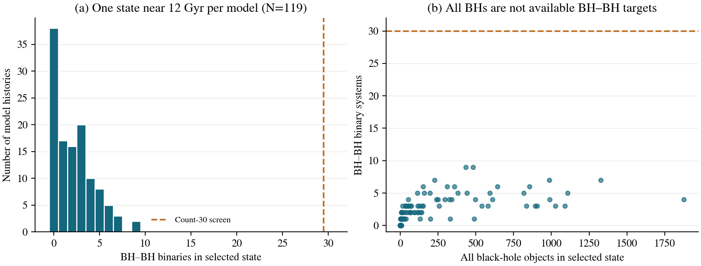
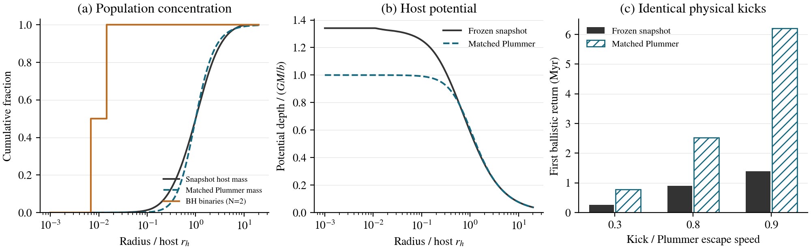
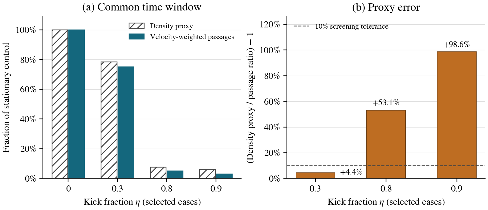

# Black-hole recoil dynamics

Independent physics research · Stellar dynamics and gravitational-wave source environments

**Contributed by Hemanth.**

[](https://github.com/heyyymonth/black-hole-recoil-dynamics/actions/workflows/tests.yml)
[](LICENSE)
[](https://github.com/heyyymonth/black-hole-recoil-dynamics/releases/tag/v0.1.1)

[Research paper](output/pdf/central-residence.pdf) · [LaTeX source](paper/manuscript.tex) · [Source archive](output/pdf/manuscript-source.zip) · [E005 target inventory](docs/e005-target-availability.md) · [Research context](docs/cluster-dynamics-context.md) · [Baseline release](https://github.com/heyyymonth/black-hole-recoil-dynamics/releases/tag/v0.1.1)

## Research question

How does a retained black-hole remnant's motion affect its access to potential companions, and how accurately does density exposure represent that access?

E001/E002 follow a test particle in a fixed Plummer potential and measure return, residence, and density exposure. E003 adds a prescribed tracer-binary population and velocity-dependent close-passage cross section. E004 compares those population and potential assumptions with an externally evolved CMC cluster snapshot. E005 checks target abundance across the available late-time cluster summaries. Together these test ingredients connecting recoil motion to companion access; they do not yet predict repeated-merger rates.

## Experiments

| Experiment | Calculation | Research record |
|---|---|---|
| E001 | First central return as a function of kick speed | [Method and results](docs/e001-ballistic-return.md) · [Table](results/e001/return_times.csv) |
| E002 | Central residence and density exposure over finite windows | [Method and results](docs/e002-core-exposure.md) · [Tables](results/e002/) |
| E003 | Density proxy versus velocity-weighted close passages over a common time window | [Protocol](docs/e003-protocol.md) · [Method and results](docs/e003-encounter-accessibility.md) · [Table](results/e003/encounters.csv) |
| E004 | Companion inventory and ballistic returns in an evolved cluster snapshot | [Protocol](docs/e004-protocol.md) · [Method and results](docs/e004-cluster-validation.md) · [Tables](results/e004/) |
| E005 | BH–BH target abundance across available late-time CMC model histories | [Protocol](docs/e005-protocol.md) · [Method and results](docs/e005-target-availability.md) · [Tables](results/e005/) |

**Latest result:** E005 audits **7,537 saved states across 126 available model histories**. Of 119 histories with a state near 12 Gyr, the median is **two BH–BH binaries**, 38 contain none, and the maximum is nine. The maximum across all inspected states is 15. Small instantaneous target counts therefore extend beyond E004's selected snapshot. This does not calibrate a companion distribution: summaries lack joint phase space, and these equal-weight old-cluster states are not conditioned on merger events. [Findings, validation and the resulting next question](docs/e005-target-availability.md).



E004 finds only **two BH–BH binaries** among 682,583 systems in one evolved cluster snapshot. At identical physical kicks, a Plummer model matched to current host mass and half-mass radius predicts returns **2.96, 2.81, and 4.45 times as long** as the frozen snapshot potential. Direct full-shell checks place compression errors below 0.16%. **Live recoil trajectories remain unvalidated**. [Results and limitations](docs/e004-cluster-validation.md) · [Specific next experiments and existing research](docs/cluster-dynamics-context.md).



In E003, density exposure overestimates normalized close-passage opportunities by **4.4%, 53.1%, and 98.6%** at kick fractions 0.3, 0.8, and 0.9. Two cases fail the predeclared 10% approximation screen. Gravitational focusing dominates this specified configuration; faster relative motion reduces its contribution. Absolute expected passage counts are tiny: 1.61e-6 for the stationary control and 4.71e-8 for the 0.9 kick during the common 0.149 Myr window.



E001–E003 are controlled numerical benchmarks. E003 calculates an expected close-passage count in an imposed bath along an unperturbed orbit; it does not simulate encounter outcomes or infer mergers. Their trajectories and E004's frozen-potential comparisons omit dynamical friction and host evolution during the recoil interval. E004/E005 use outputs of separately evolved clusters; E005 calculates no trajectories. E003 screens remnant apocenters against a declared outer radius without truncating the host. The former E002 near-escape example remains an isolated-model limit and does not pass that screen. No observed gravitational-wave data are used.

The [unreviewed manuscript](output/pdf/central-residence.pdf), **Companion access after black-hole recoil: dynamical benchmarks and sparse binary populations**, integrates **all five completed studies**. Its sections use descriptive physical objectives rather than experiment IDs. The catalog census now supports the paper's synthesis and its explicitly untested hypothesis: changing target availability during displacement may add predictive information beyond a stationary population and first-return time. The [claim-to-evidence record](paper/CLAIMS.md) maps results to repository records and separates evidence from the proposed test. No calibrated merger-rate or live-trajectory claim is made. The archived v0.1.1 release remains the earlier orbital-benchmark paper.

[Physical assumptions](docs/problem.md) · [Scientific relevance](docs/relevance.md) · [References](docs/references.md)

## Reproduce the results

Python **3.11** is the supported reference environment. From the repository root:

```sh
python3.11 -m venv .venv
source .venv/bin/activate
python -m pip install -r requirements-lock.txt
python -m pytest -q
python experiments/verify_results.py
python experiments/verify_e003.py
python experiments/verify_e004.py
python experiments/verify_e005.py
```

The **180 tests** cover independent trajectories, numerical velocity integrals, conservation laws, analytical limits, scaling, catalog accounting, age selection and archive integrity. The verifiers reproduce **146 baseline rows, 4 E003 rows, E004's 5 population rows, 12 trajectory cases and 160 profile points**, and E005's **7,537 state rows, 126 history summaries and 119 age-selected states**. E005 also includes an independent scalar census. Source/input/output hashes are checked. Saved states are not independent astronomical observations.

To regenerate E001/E002 tables and figures:

```sh
python experiments/run.py
python experiments/verify_results.py
```

For E003, commit its source inputs, then run:

```sh
python experiments/run_e003.py
python experiments/verify_e003.py
```

For E004, `python experiments/fetch_e004.py` downloads approximately 46 MB of pinned external inputs to ignored local cache; the verifier also fetches missing inputs. After committing source changes, use `python experiments/run_e004.py` to regenerate. The [E004 manifest](results/run_e004.json) records external and local input hashes. Subsequent checks work offline with the populated cache.

For E005, `python experiments/fetch_e005.py` downloads approximately 79 MiB of pinned archive data and verifies the 7,537 locked summary files; subsequent checks use the local cache. After committing source inputs, `python experiments/run_e005.py` regenerates its tables and figure. Its [manifest](results/run_e005.json) records each input's SHA-256 and the generating revision. Raw external files are not redistributed.

Each runner replaces its corresponding outputs. E001–E003 need no network after dependency installation. The [baseline configuration](experiments/config.json) and [E003 configuration](experiments/e003.json) fix inputs; [baseline](results/run_all.json) and [E003](results/run_e003.json) manifests record source revisions, hashes, and library versions. [Paper build instructions](paper/README.md) cover the separate PDF dependencies and source.

## Repository structure

| Path | Purpose |
|---|---|
| `src/recoil_dynamics/` | Reusable orbit, close-passage, snapshot-parsing, and shell-potential calculations |
| `experiments/` | Configuration, execution, result verification, and record template |
| `tests/` | Independent numerical and analytical validation |
| `results/` | Generated tables, figures, provenance, and verification record |
| `docs/` | Physical problem, experiment records, and literature context |
| `paper/` | LaTeX manuscript, BibTeX, vector figures, and build script |
| `output/pdf/` | Working paper, source archive, and build manifest |

[Contribution guidance](CONTRIBUTING.md) describes how to add a separately identified experiment with its own assumptions, configuration, validation, and results.

## Citation and reuse

The current integrated manuscript is revision **0.3.0-manuscript.2**, with ten pages, six tables and six vector figures. Use its [paper-specific BibTeX citation](paper/CITATION.bib) when referencing the paper; it identifies [immutable manuscript snapshot 7d125e1](https://github.com/heyyymonth/black-hole-recoil-dynamics/tree/7d125e118239b1acdf47d12b9fa8c8c18bca28e9), separately from the software. It remains unreviewed and has no DOI. The previous eight-page revision is preserved at [snapshot 0b2767e](https://github.com/heyyymonth/black-hole-recoil-dynamics/tree/0b2767ebe455eb891bffddb03a7e65cc442539a7). Root citation files below continue to identify the earlier baseline software release.

Athota, Venkata Hemanth (2026). *Black-hole recoil dynamics: central residence and density exposure in a Plummer potential*. Version 0.1.1. [Versioned research release](https://github.com/heyyymonth/black-hole-recoil-dynamics/releases/tag/v0.1.1).

Use [CITATION.cff](CITATION.cff), [BibTeX](CITATION.bib), or GitHub's **Cite this repository** control. Cite the version used for the calculation. This release has no DOI; the versioned release identifies the research snapshot.

Those citation files describe the E001/E002 v0.1.1 baseline. For E003, use its [BibTeX citation](results/e003/CITATION.bib), which identifies [results snapshot 7944b82](https://github.com/heyyymonth/black-hole-recoil-dynamics/tree/7944b82b3c99e070b7c312011020e4ee53b4255d). The [E003 manifest](results/run_e003.json) also identifies the generating source commit. This commit-based citation has no DOI; E003 is not part of v0.1.1.

For E004, use its [BibTeX citation](results/e004/CITATION.bib), identifying [results snapshot 14d9f49](https://github.com/heyyymonth/black-hole-recoil-dynamics/tree/14d9f493e6eeae25e51a244dfb60789753992db6). Its [manifest](results/run_e004.json) distinguishes generating code from external simulation provenance. Cite the upstream CMC/cmctoolkit sources as appropriate when using those data. This snapshot also contains the working abstract revision; it has no DOI and does not replace v0.1.1.

For E005, use its [BibTeX citation](results/e005/CITATION.bib), identifying [results snapshot 80d82f8](https://github.com/heyyymonth/black-hole-recoil-dynamics/tree/80d82f85d1c84fa7ef42fc40f71a1cbc5439c172). Its [manifest](results/run_e005.json) records the generating source and all consumed external input hashes. Cite the upstream CMC/cmctoolkit research when reusing those data. This audit is now incorporated into the current manuscript while retaining its own immutable experiment citation; it is not part of the v0.1.1 baseline release and has no DOI.

Original code, technical documentation, and generated research artifacts are provided under the [MIT license](LICENSE). Preserve its copyright and permission notice when reusing substantial portions. Academic citation is requested separately from the license conditions. Referenced publications, dependencies, and external simulation files retain their own rights and licenses. The fetched CMC snapshot and upstream summaries are not redistributed or relicensed by this repository.

[Author and contact](AUTHORS.md) · [Release record](CHANGELOG.md)
