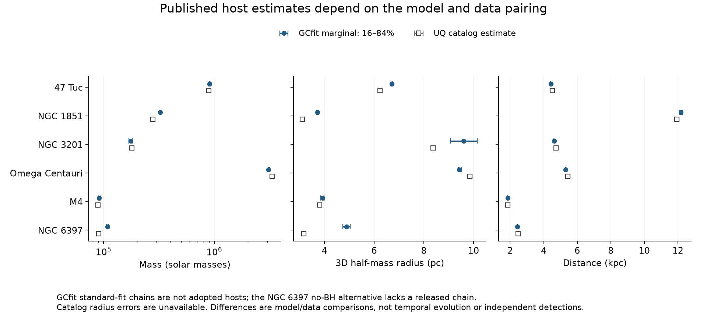
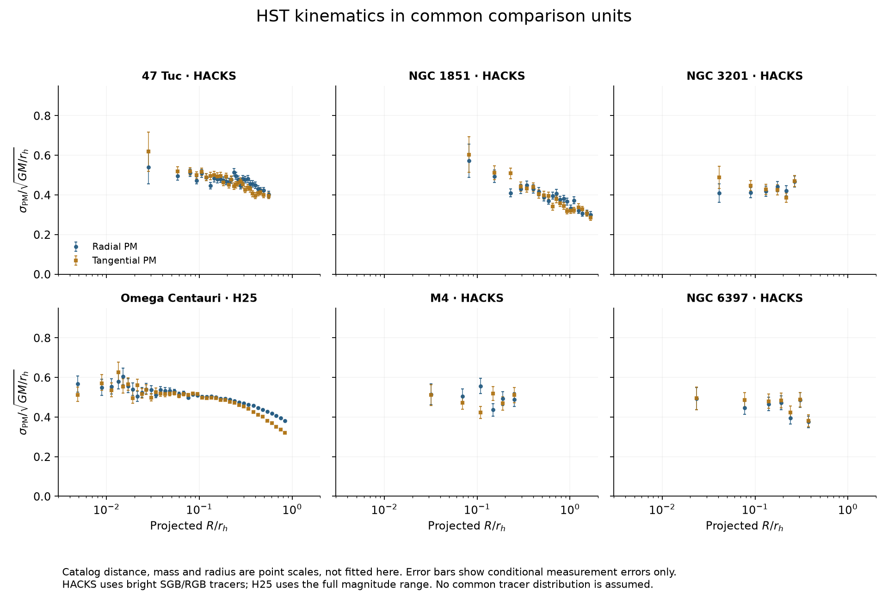
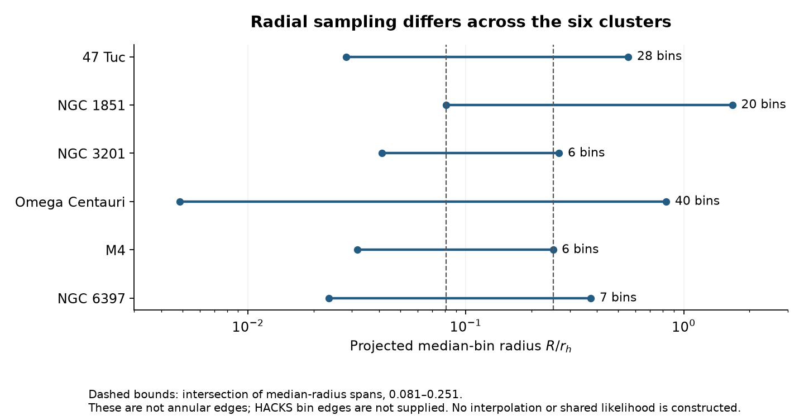

# Observed-cluster data assessment

Venkata Hemanth Athota · 24 October 2026

## Finding

A common observation schema and a common host-parameter interface are feasible for all six candidates. The evidence does **not** yet justify a single universal stellar distribution or six calibrated recoil backgrounds. Standardize the variables and units while keeping each cluster's joint parameter distribution, source selection, and model assumptions.

The completed work retrieves original public products, checks their contents, converts units for comparison, and describes published posteriors. It performs no host fit, potential reconstruction, friction calculation, recoil integration, or residence experiment. The research manuscript is unchanged.

[Executed notebook](../analysis/cluster_data/cluster_data_audit.ipynb) · [Source manifest](../data/observed-clusters/sources.json) · [Candidate host records](../data/observed-clusters/candidate-hosts.json) · [Common host schema](cluster-host-schema.md)

## Sources and actual coverage

The six candidates are NGC 0104 (47 Tuc), NGC 1851, NGC 3201, NGC 5139 (Omega Centauri), NGC 6121 (M4), and NGC 6397. They are deliberately selected observed clusters, not the CMC simulation histories.

The local source cache contains 51 files, 269,365,248 bytes, with exact hashes and retrieval URLs. This includes the complete original Gaia EDR3 v2 archive, the relevant original HST binned products, six full published GCfit standard-fit chains, historical candidate observation bundles, and supporting catalog/profile products. It is a bounded collection for this question, not every observation ever made of these clusters.

| Cluster | Original Gaia field-catalog rows | Original HST radial bins | Compiled kinematic rows | Flagged compiled rows | Surface-profile bins |
|---|---:|---:|---:|---:|---:|
| 47 Tuc | 144,761 | 28 | 89 | 0 | 72 |
| NGC 1851 | 12,688 | 20 | 54 | 4 | 95 |
| NGC 3201 | 63,171 | 6 | 41 | 0 | 54 |
| Omega Centauri | 228,055 | 40 | 141 | 1 | 95 |
| M4 | 69,417 | 6 | 33 | 0 | 54 |
| NGC 6397 | 103,786 | 7 | 60 | 15 | 52 |
| **Total** | **621,878** | **107** | **418** | **20** | **422** |

Gaia field rows include foreground/background stars; they are not established cluster members. The audit checks membership-probability bounds, astrometric quality flags, uncertainty validity, and identifier uniqueness. No within-cluster duplicate source identifiers were found. A separate diagnostic count uses the release's quality-passing flag and membership probability at least 0.9; it is explicitly not an adopted likelihood selection. Missing colors are recorded, not silently discarded.

The HST combined, projected radial, and projected tangential components provide 321 scalar records from 107 bins, not 321 independent experiments. Five clusters use [HACKS / Libralato et al. (2022)](https://archive.stsci.edu/hlsp/hacks); Omega Centauri uses the original [oMEGACat VI / Häberle et al. (2025) release](https://zenodo.org/records/14978551).

The [Gaia EDR3 v2 release](https://zenodo.org/records/4891252) also supplies 101 smooth profile samples per cluster. These 606 records are **correlated fitted curves**, not independent measured bins. Their 12th column lacks a definition in the archived README and is retained without interpretation. The [source method](https://arxiv.org/html/2102.09568) fits a spline to the stellar data; the released profiles do not provide their full radial covariance.

## Candidate values, with their meaning preserved

The following are point estimates from one captured [Baumgardt structural-table path](https://people.smp.uq.edu.au/HolgerBaumgardt/globular/newdata/parameter.html). Mass, radii, central dispersion, and escape speed are model-derived quantities. They are useful comparison scales, not a complete adopted host.

| Cluster | Distance (kpc) | Mass (solar masses) | 3D half-mass radius (pc) | Central escape speed (km/s) | Scale v0 (km/s) | Scale t0 (Myr) |
|---|---:|---:|---:|---:|---:|---:|
| 47 Tuc | 4.52 ± 0.03 | 890,000 ± 5,000 | 6.24 | 51.0 | 24.77 | 0.246 |
| NGC 1851 | 11.95 ± 0.13 | 278,000 ± 4,000 | 3.11 | 42.7 | 19.61 | 0.155 |
| NGC 3201 | 4.74 ± 0.04 | 180,000 ± 3,000 | 8.37 | 18.6 | 9.62 | 0.851 |
| Omega Centauri | 5.43 ± 0.05 | 3,320,000 ± 10,000 | 9.85 | 61.9 | 38.07 | 0.253 |
| M4 | 1.85 ± 0.02 | 88,800 ± 1,100 | 3.81 | 19.5 | 10.01 | 0.372 |
| NGC 6397 | 2.48 ± 0.02 | 90,100 ± 900 | 3.17 | 23.4 | 11.06 | 0.280 |

The source supplies no uncertainty alongside these half-mass radii or escape speeds. Their missing uncertainty is not zero. The displayed mass errors do not encompass all model systematics. The gravitational scales v0 = sqrt(G M / rh) and t0 = rh / v0 are derived display scales; neither is a measured central velocity dispersion or a friction/relaxation time. Their full uncertainty has not been propagated.

The root-path catalog differs from the selected /newdata/ path. Both versions are retained separately in the audit. They are not averaged, patched together, or treated as temporal evolution.

## Which distribution would supply a host?

The six published standard-fit [GCfit chains](https://github.com/nmdickson/GCfit-results/tree/c45a03b1681570b6ee96be76f362894c6628e1f1) use the same 13-coordinate pattern:

W0, M, rh, log10 anisotropy radius, g, delta, s2, F, a1, a2, a3, BHret, distance.

The units and physical versus nuisance roles are specified in the [common schema](cluster-host-schema.md). The reusable object is a **weighted joint posterior row**, not an independent Gaussian for each coordinate. No posterior rows were resampled and no model was evaluated here.

Selected direct weighted medians and 16th–84th percentile intervals are:

| Cluster | Mass (10^5 solar masses) | 3D half-mass radius (pc) | Distance (kpc) |
|---|---:|---:|---:|
| 47 Tuc | 9.045 [8.996, 9.094] | 6.714 [6.679, 6.749] | 4.420 [4.408, 4.431] |
| NGC 1851 | 3.250 [3.211, 3.288] | 3.712 [3.670, 3.757] | 12.183 [12.106, 12.268] |
| NGC 3201 | 1.757 [1.699, 1.814] | 9.598 [9.070, 10.152] | 4.636 [4.603, 4.671] |
| Omega Centauri | 30.824 [30.693, 31.489] | 9.419 [9.402, 9.529] | 5.300 [5.287, 5.327] |
| M4 | 0.911 [0.894, 0.929] | 3.920 [3.859, 3.982] | 1.852 [1.838, 1.866] |
| NGC 6397, standard fit | 1.084 [1.061, 1.109] | 4.887 [4.747, 5.044] | 2.436 [2.422, 2.452] |

These are conditional published-model estimates, not observations or our newly fitted values. The NGC 6397 standard fit is not interchangeable with the authors' no-BH alternative; that alternative has a summary and figures but no corresponding chain in the inspected release.

[All 78 parameter summaries](../data/observed-clusters/derived/posterior_parameters.csv) and [native-unit covariance matrices, correlations and diagnostics](../data/observed-clusters/derived/posterior_diagnostics.json) are retained. Mass–radius correlations are approximately 0.900 for NGC 3201 and 0.944 for Omega Centauri, making independent sampling particularly inappropriate.

All six direct effective sample sizes reproduce the authors' printed values. Twelve parameter rows differ beyond three-decimal rounding in the printed mean or standard deviation. This is a method-aware comparison: the historical [GCfit summary routine](https://github.com/nmdickson/GCfit/blob/e4154e8e3e2505d2c49248a71c1eebcea5844442/gcfit/analysis/runs.py) averages resampled-run statistics, while this audit reports direct weighted empirical moments. These small differences do not establish a mismatched chain. They also do not resolve the separate absence of exact input-file hashes and software revisions in the run metadata.

## What homogenization does

Every observation record retains cluster ID, source/release, component, projected radius, native value, asymmetric errors, tracer selection, uncertainty convention, and overlap/covariance status. Available bin boundaries and star counts are preserved. A missing boundary or covariance is left missing.

For display, use one distance source consistently:

- Physical projected radius is D times the angular radius in radians.
- Transverse velocity dispersion is 4.74047046 D sigma_mu, with D in kpc and sigma_mu in mas/yr.
- LOS dispersions already in km/s receive no proper-motion conversion.
- Comparison coordinates use projected R/rh and sigma/v0. No radial interpolation or universal profile fit is performed.

The common distance error and derivatives with respect to distance are recorded for future propagation. At first order, a shared distance contributes sigma_D squared times the outer product of those derivatives to a converted-data covariance. This contribution is **not** added as if each bin had an independent distance error. A future inference should preferably compare predictions to the native angular measurements, with distance inside the joint host posterior.

The plots condition on catalog point scales. Their error bars contain only the converted measurement errors; uncertainty in distance, mass, radius and their correlations is not fully propagated.

The HST median-radius spans overlap across all six only over approximately **0.081–0.251 in projected R/rh**, using these catalog scales. This is the intersection of spans of published median radii, not exact annular coverage or evidence for adequate sampling between them. HACKS bin edges are not supplied.

## Material limitations and handling

| Issue | Observed evidence | Handling and consequence |
|---|---|---|
| Compiled rows requiring reconciliation | Four zero-radius NGC 1851 rows, one all-zero Omega Centauri row, and 15 NGC 6397 L24 rows with dispersion equal to both errors | Preserve originals, flag 20 rows, keep them out of any future approved-input view until reconciled. No guessed correction. |
| Duplicate candidate keys | Four NGC 1851 records share one radius/source/component key | Record the group; do not silently deduplicate it into a physical central measurement. |
| Different tracer populations | HACKS profiles use stars brighter than the main-sequence turnoff; H25 Omega Centauri profiles use the full magnitude range | Common units do not imply a common stellar mass distribution or equal dispersion. Retain selection and mass-dependent information. |
| Reused observations | Compiled HST/Gaia series and their originals refer to overlapping data; GCfit also uses such observations | Keep alternative views separate. Do not multiply a posterior by its own input likelihood or count compiled and original data twice. |
| Rotation | HST transformations can remove sky-plane rotation; Gaia releases provide rotation curves | Missing streaming information is not zero rotation. 47 Tuc and especially Omega Centauri require explicit treatment. |
| Fitted host/data/software pairing | Older chains use BHret; current software uses changed conventions and observations. Omega Centauri LOS and PM resources changed after the old summaries | Pin historical candidates, but mark exact compatibility unresolved until reproduction. Do not insert old parameters into current defaults. |
| Model-dependent NGC 6397 structure | Standard-fit half-mass radius differs strongly from the catalog, and the preferred no-BH alternative lacks a released chain | Keep this as a model-sensitivity case; do not adopt the standard chain silently. |
| Missing local distribution functions | Scalar catalogs and projected profiles do not specify mass-resolved local velocity distributions | No friction/diffusion coefficients or calibrated potential are supplied by this audit. |

The compiled surface files stitch number counts and sometimes surface brightness; their normalization is not a three-dimensional mass density. Published chains contain pointwise derived density and cumulative-mass bands, whose inventory is retained. Bands alone are not complete mutually consistent host realizations; independently combining median density, mass and velocity curves can break physical consistency.

The L24 NGC 6397 source has a public stellar catalog but no verified original binned-dispersion product resolving the suspect compilation entries. Its faint main-sequence tracer selection also differs from HACKS. The available valid original HACKS series is retained; the L24 values are not repaired. [Original L24 study](https://arxiv.org/html/2411.02487).

## Decision for the experiment foundation

Use **one interface with a separate conditional host distribution per cluster**. NGC 3201 and 47 Tuc are the initial fit-reproduction candidates; NGC 1851 and M4 add structural comparisons. Keep NGC 6397 and Omega Centauri as explicitly more demanding model tests.

The data are ready for source-aware comparison and selection of a reconstruction method. They are not yet ready for six interchangeable friction simulations. The next required calculation is to reproduce a compatible published host fit and its projected observables, then obtain consistent species densities and velocity distributions from each joint realization.

Merger-conditioned launch positions and velocities, recoil vectors, remnant masses, encounter cutoffs, external evolution, region boundaries and horizons remain separate inputs. These cluster observations do not determine them. The [candidate records](../data/observed-clusters/candidate-hosts.json) leave those fields unassigned and execution disabled.

## Reproduction and rights

Run the retrieval, analysis and notebook instructions in the [data package](../data/observed-clusters/README.md). Original large files remain in a local ignored cache; their exact URLs and hashes are versioned. A changed upstream file fails verification rather than silently changing this analysis.

HACKS and the two Zenodo releases identify CC BY 4.0 terms and require their original attribution. Other provider material retains its own rights; this repository's MIT license applies to our analysis code and documentation, not as a blanket relicensing of external data. Preserve the primary source citations in the manifest and data README.
