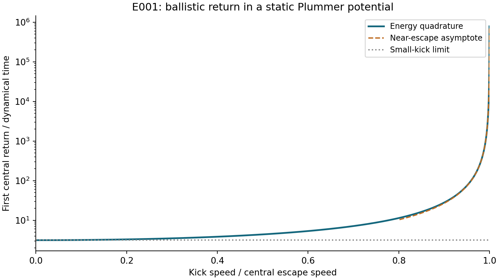

# E001: first central return after a recoil kick

**Researcher:** Venkata Hemanth Athota

**Model:** central radial kick in a static, isolated Plummer potential

**Data:** generated by energy quadrature; no observed-event data

## Question

How does the time to the first central return change as a bound kick approaches the central escape speed?

## Method

With $\eta=v_k/v_{\rm esc}(0)$ and $0<\eta<1$, energy conservation gives the apocenter

$$x_a=\frac{\eta\sqrt{2-\eta^2}}{1-\eta^2}.$$

The first central-return time, in units $t_d=\sqrt{b^3/(GM)}$, is

$$P=2\int_0^{x_a}\frac{dx}{\sqrt{2[(1+x^2)^{-1/2}-(1-\eta^2)]}}.$$

The substitution $x=x_a\sin\theta$ removes the endpoint singularity. Writing $s=\sqrt{1+x_a^2\sin^2\theta}$ and $s_a=1/(1-\eta^2)$ gives

$$\frac{dt}{d\theta}=\sqrt{\frac{s s_a(s+s_a)}{2}},\qquad P=2\int_0^{\pi/2}\frac{dt}{d\theta}\,d\theta.$$

The tabulated kicks are specified in `experiments/config.json`. The plotted curve extends to $\eta=0.9999$. Both absolute and relative quadrature tolerances are $10^{-11}$.

## Results

| Kick / escape | Apocenter / b | First return / dynamical time |
|---:|---:|---:|
| 0.50 | 0.881917 | 4.395561 |
| 0.80 | 2.591534 | 11.371439 |
| 0.90 | 5.167285 | 27.972769 |
| 0.95 | 10.207544 | 74.156668 |
| 0.99 | 50.241305 | 792.551744 |
| 0.999 | 500.249126 | 24856.344701 |

The small-kick limit is $P\to\pi$. The near-escape limit is

$$P\sim\frac{\pi}{\sqrt{2}}(1-\eta^2)^{-3/2}.$$

The numerical curve approaches both limits. At $\eta=0.99$, the remnant is bound but its excursion extends to about $50b$ and lasts about $793t_d$.

## Verification and interpretation

The tests independently integrate the signed-coordinate equation of motion and check the central crossing and conserved energy. Analytical small-kick and near-escape limits supply checks independent of the ODE solver.

At exactly zero kick the object is stationary; the limiting value $\pi$ is not assigned as a physical waiting time. At a nonzero bound kick the first center crossing is followed by another excursion. It does not represent settling by dynamical friction.

The large near-escape apocenters make tidal boundaries and host evolution material limitations. The result is a benchmark in the specified potential, not an inferred cluster return time.

[Complete numerical table](../results/e001/return_times.csv) · [Execution provenance](../results/run_all.json) · [Physical context](problem.md)
