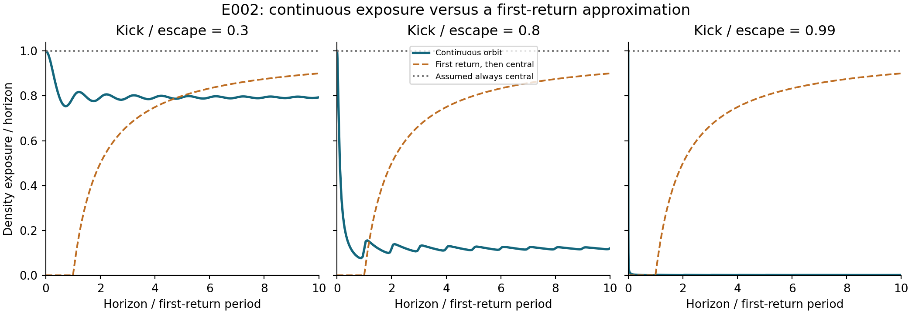
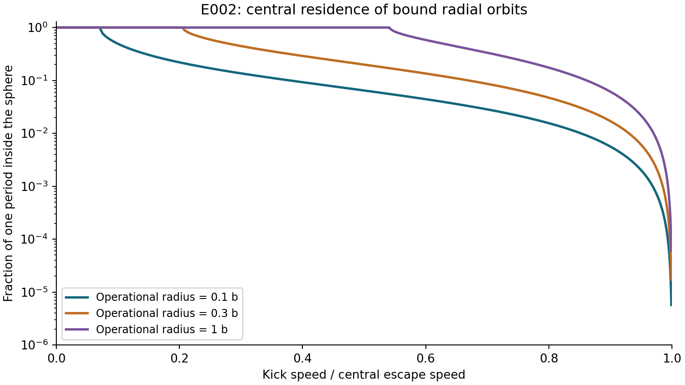

# E002: finite-window central residence and density exposure

**Researcher:** Venkata Hemanth Athota

**Model:** the same collisionless Plummer orbits as E001

**Data:** generated trajectories evaluated through energy quadrature; no observed-event data

## Question

Does replacing continuous orbital motion with either permanent central residence or a wait until the first return preserve the remnant's exposure to a concentrated environment?

## Method

For horizon $H$, we measure the time $C(H,c)$ inside a sphere of radius $cb$, and the normalized density integral

```math
I(H)=\int_0^H w[x(t)]\,dt,\qquad w(x)=(1+x^2)^{-5/2}.
```

We compare $I(H)$ with $H$ (assumed always central) and $\max(H-P,0)$ (first return followed by permanent central residence). The latter deliberately suppresses all exposure before $P$ and assumes unit density afterward. It is not a model of frictional settling.

The outgoing integrals use E001's endpoint transformation. Exposure quadrature is divided at physical-radius scales so that brief central passages remain resolved when the apocenter is large. Completed periods are counted exactly; the last partial period is evaluated by inversion of the outgoing time integral. Core crossings are located by quadrature rather than estimated from a coarse time-sampled indicator.

The grid contains 11 kick fractions from 0 to 0.999, operational radii $c=0.1,0.3,1$, and seven fixed horizons from 1 to 1000 dynamical times. A separate table uses $H/P=0.1,0.5,1,2,10$ for the ten nonstationary kicks. Fixed and period-scaled horizons answer different questions and are kept separate. The complete inputs are in `experiments/config.json`.

## Results

At $\eta=0.99$, one full radial period gives:

| Quantity | Value |
|---|---:|
| Period $P$ | 792.551744 dynamical times |
| Density exposure $I(P)$ | 1.029215 dynamical times |
| Mean normalized density $I(P)/P$ | 0.001298609 |
| Time inside $`r\lt b`$ | 1.530574 dynamical times |
| Fraction inside $`r\lt b`$ | 0.001931197 |

Although the orbit is bound, the mean sampled density is about **0.130%** of the central value, and only **0.193%** of the period is spent inside the declared sphere $`r\lt b`$. This describes the ideal orbit, not a population of observed remnants.

The same measures vary substantially across the tested kicks:

| Kick / escape | Mean normalized density | Fraction of period inside $`r\lt b`$ |
|---:|---:|---:|
| 0.30 | 0.793277 | 1.000000 |
| 0.80 | 0.120409 | 0.174465 |
| 0.99 | 0.00129861 | 0.00193120 |



At $H=P$, the wait prescription assigns zero exposure while the trajectory gives 1.029215. At $H=10P$, the continuous trajectory gives $10I(P)$, whereas the wait prescription assigns $9P$. The direction of error therefore reverses. A permanent-central approximation loses the repeated departures from the dense region.



Central residence also depends on the chosen radius. An orbit remains entirely inside a sphere if

```math
\eta\le\sqrt{1-\frac{1}{\sqrt{1+c^2}}}.
```

For $c=1$, this threshold is approximately 0.541196. Residence inside a sphere and density-weighted exposure are distinct quantities: density varies even along an orbit that never leaves the sphere.

## Analytical checks

For a stationary object, $I(H)=C(H,c)=H$. For nonzero bound kicks, exposure and occupancy repeat every $P$, so $I(nP)=nI(P)$.

As the kick tends to escape, the period diverges but the exposure per excursion stays finite. For the marginally bound outgoing orbit,

```math
\dot{x}=\sqrt{2}(1+x^2)^{-1/4},
```

which gives the bound full-excursion limit

```math
\lim_{\eta\to1^-}I(P)=\sqrt{\frac{\pi}{2}}\frac{\Gamma(7/4)}{\Gamma(9/4)}=1.0166557018.
```

Together with E001's period asymptote, this yields

```math
\frac{I(P)}P\sim\frac{\Gamma(7/4)}{\sqrt{\pi}\Gamma(9/4)}(1-\eta^2)^{3/2}.
```

The tests check these limits, orbit energy, accumulated exposure from an independent ODE integration, event-based core residence, repeated periods, crossing continuity, and numerical convergence. Exactly stationary cases are handled separately from the small-amplitude return-time limit.

## Interpretation

A retention flag or a rule that treats first return as permanent central residence does not preserve finite-window exposure. An exact return time together with this fixed one-parameter orbital model can recover the orbit; the approximation test does not establish non-identifiability. The first-return comparison is not uniformly conservative: it can miss early exposure and exaggerate late exposure.

Density exposure alone is not an encounter rate. The calculation contains neither a companion distribution distinct from the host density nor a velocity-dependent cross section, binary fraction, formation process, friction or tidal boundary. It therefore does not estimate a merger probability or directly test a published frictional-return prescription.

[Cycle table](../results/e002/cycles.csv) · [Fixed-horizon table](../results/e002/fixed_horizons.csv) · [Period-scaled table](../results/e002/relative_horizons.csv) · [Execution provenance](../results/run_all.json) · [Relevance review](relevance.md)
