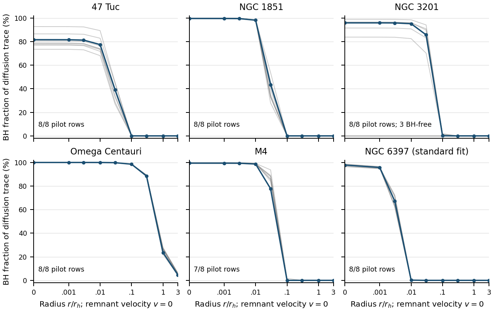

# Six-cluster host and local-transport comparison

The same conditional host and local scattering experiments are evaluated for all six shortlisted clusters. These calculations test numerical consistency and expose differences between candidate environments; they do not compare diffusion with resolved encounters or calculate remnant residence.

## Calculation design

- One maximum-posterior-quadrature-weight joint row per cluster repeats the original reference selection. It is not a posterior mode or a typical host.
- Each accepted reference repeats the same 20 local states: four radii, three speed fractions and radial/tangential directions, with a 60-solar-mass diagnostic probe.
- Eight fixed-seed weighted joint draws per cluster form a sensitivity pilot. Failed rows are retained and not replaced. These eight draws do not establish converged credible intervals.
- Nine zero-speed radii resolve the inner region more finely. Full anisotropic number distributions determine the integrals; all coefficients use the same unit constant Coulomb logarithm.
- The released 4,000 derived realizations per cluster are summarized separately; they are not aligned by row number to the nested chains or treated as observed BH counts.

## Reference results

| Cluster | Expected BH count | BH mass (solar masses) | Probe / BH mass | Central BH diffusion share | Share at 0.1 rh |
|---|---:|---:|---:|---:|---:|
| 47 Tuc | 65.9 | 442.3 | 0.1357 | 81.579% | 0.01328% |
| NGC 1851 | 16 | 197.7 | 0.3034 | 99.542% | 0.0004788% |
| NGC 3201 | 4.28 | 61.16 | 0.981 | 95.836% | 0.0846% |
| Omega Centauri | 1.21e+04 | 1.77e+05 | 0.0003391 | 99.999% | 98.52% |
| M4 | 5.33 | 68.32 | 0.8782 | 99.431% | 0.02131% |
| NGC 6397 (standard fit) | 2.94 | 19.73 | 3.041 | 97.793% | 3.344e-12% |

Shares refer to the diffusion trace at zero remnant velocity, with equal species Coulomb-log normalization. They are local coefficients, not fractions of the time a remnant spends encountering BHs. Expected counts need not be integers; they do not specify a discrete count distribution.

Blue: selected reference. Gray: accepted pilot rows. The connecting lines locate sampled values; they are not an adopted trajectory coefficient interpolator or a confidence band.

## Published model variation

| Cluster | Expected BH count: median [16th, 84th percentile] | Zero-BH derived rows |
|---|---:|---:|
| 47 Tuc | 61.9 [51.2, 81.1] | 0/4000 |
| NGC 1851 | 15 [13.1, 17.6] | 0/4000 |
| NGC 3201 | 0.926 [0, 4.13] | 1899/4000 |
| Omega Centauri | 1.24e+04 [1.21e+04, 1.3e+04] | 0/4000 |
| M4 | 6.17 [3.99, 9.65] | 28/4000 |
| NGC 6397 (standard fit) | 3.08 [2.84, 3.31] | 0/4000 |

These are empirical summaries of the released derived model draws, conditional on each standard model. In particular, the selected NGC 3201 reference is not representative of the zero-BH part of that distribution. Subsystem radii and probe/reservoir ratios remain undefined in absent-BH rows.

## Reconstructed joint-row sensitivity

| Cluster | Numerically accepted hosts | Accepted zero-speed profiles | Central BH share: pilot min–max | Zero-BH pilot hosts |
|---|---:|---:|---:|---:|
| 47 Tuc | 8/8 | 8/8 | 73.459–92.693% | 0 |
| NGC 1851 | 8/8 | 8/8 | 99.639–99.901% | 0 |
| NGC 3201 | 8/8 | 8/8 | 0.000–98.759% | 3 |
| Omega Centauri | 8/8 | 8/8 | 99.997–100.000% | 0 |
| M4 | 7/8 | 7/8 | 99.040–99.752% | 0 |
| NGC 6397 (standard fit) | 8/8 | 8/8 | 96.558–98.668% | 0 |

The min–max columns describe these eight attempts only. They are not posterior credible bounds, and a small pilot cannot establish a rare-event probability. Numerical checks are applied before a row contributes to local coefficient summaries.

One M4 pilot row (nested row 6903) failed to converge to a finite model extent under the compatible reconstruction. Its original weight, full parameters and solver error are retained. It contributes no local coefficient estimate, is not replaced, and is not counted as a zero-BH host. This unresolved numerical reconstruction is distinct from a conclusion that M4 observations are unusable.

## Interpretation and suitability

The comparison distinguishes reservoir size, spatial concentration and local diffusion importance. A large central BH share does not by itself demonstrate that continuous diffusion fails; nor does a small global BH count prove failure. Their consequences require a matched encounter and residence calculation. The 60-solar-mass probe has different ratios to each cluster and BH reservoir, so these controls do not hold those ratios fixed.

NGC 3201 remains a model-sensitivity case, not a reliable observational anchor for a sparse population. NGC 6397 results describe the available standard fit only; the preferred no-BH alternative cannot be reconstructed from its summary. Numerical success for Omega Centauri does not validate a spherical nonrotating model of its complex structure. [Cluster-by-cluster quality decisions](six-cluster-data-quality.md).

The [environmental comparison](six-cluster-environment.md) repeats static boundary controls and observed-phase-point Galactic reference orbits separately. Its radius bounds concern neglected instantaneous external acceleration, not escape or cumulative trajectory error.

## Reproducibility

[Protocol](../analysis/cluster_comparison/protocol.json) · [Code and commands](../analysis/cluster_comparison/README.md) · [Reference table](../results/cluster-comparison/reference-comparison.csv) · [All attempts](../results/cluster-comparison/summary.json) · [Published-draw inventory](../results/cluster-comparison/posterior-inventory.json) · [Executed notebook](../analysis/cluster_comparison/cluster_comparison.ipynb).

Primary source products and their rights remain those in the [source manifest](../data/observed-clusters/sources.json). The comparison does not create new observational fits.
